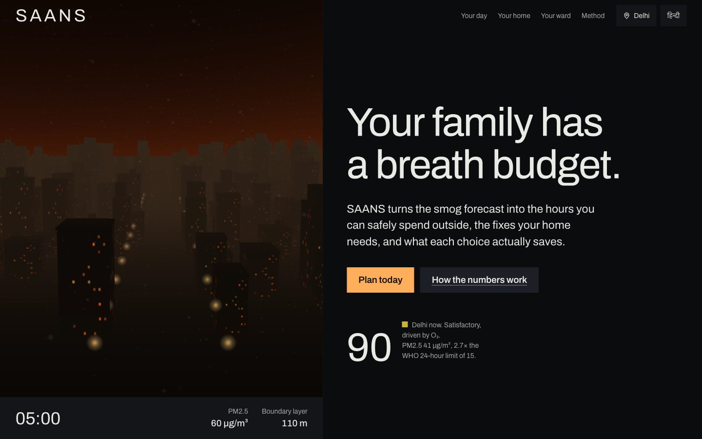
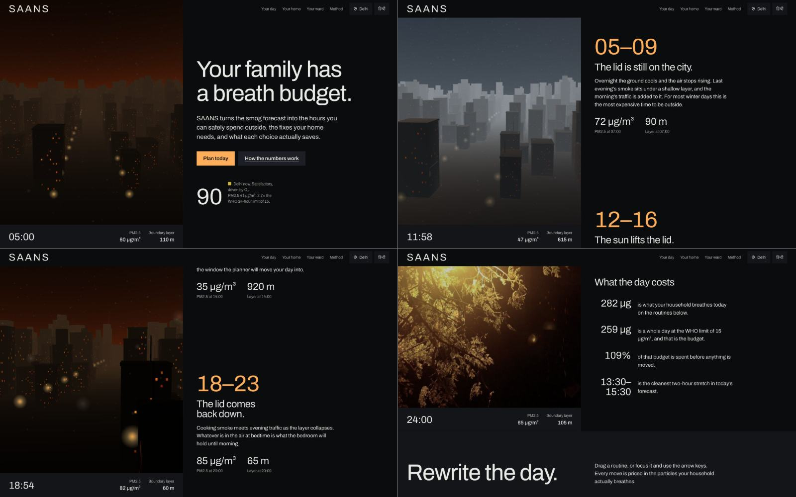
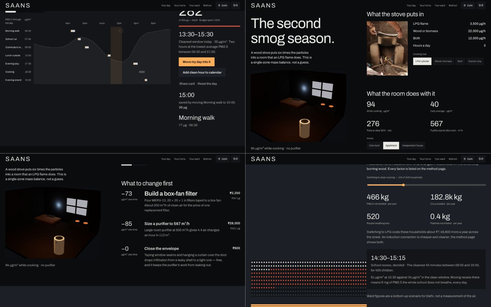
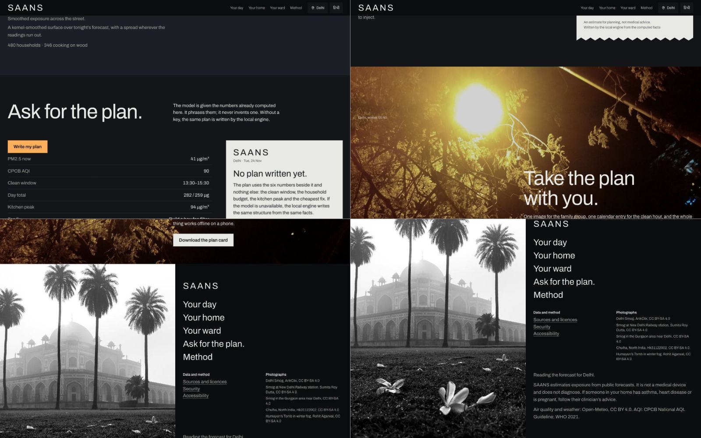
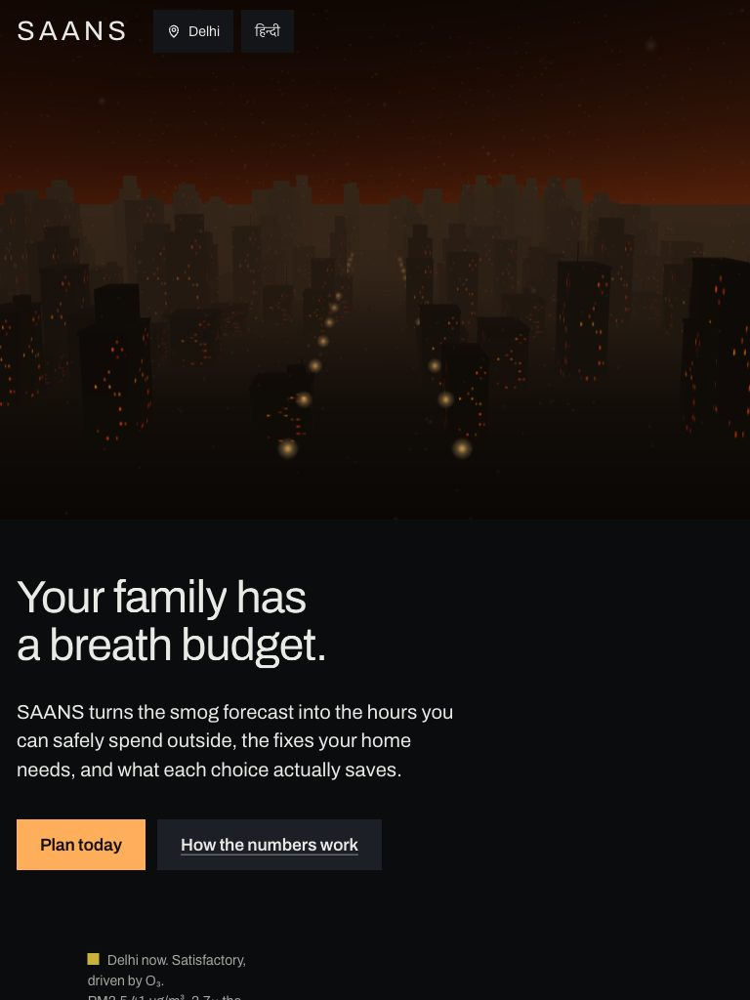
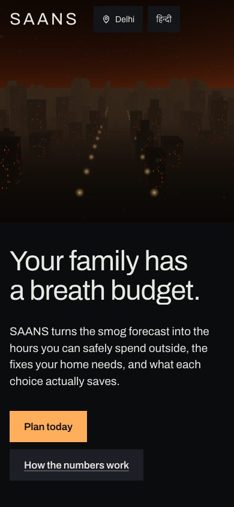
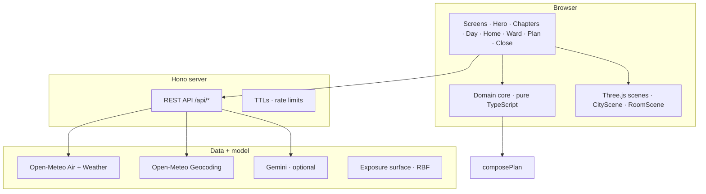
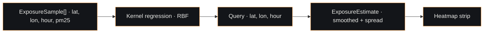

# SAANS — a breath budget for households in Delhi smog

**The city is the clock.**

SAANS turns live smog forecasts into a household breath budget: how much PM2.5 your family
actually inhales in a day against the WHO 2021 24-hour guideline, which hours of the day are clean,
what your home needs, and what each change costs — in particles, rupees and minutes.



## The idea

On this page, **the winter inversion over Delhi** becomes **the fixed half of the screen that the rest of the page is read against** — the city never moves, your day scrolls past it.

> The category owns "a chart of the air". Only SAANS owns "the city is the clock".

Drag a routine along the day and the household's inhaled-PM2.5 budget moves under your thumb. The
forecast, the indoor mass balance and the costed interventions are computed in one place; the
interface just tells the story.

## What the app does

- **Live forecast** — Open-Meteo air quality + weather, hourly PM2.5 against the WHO budget of
  **15 µg/m³ × 1440 × 0.012 ≈ 259 µg/day**.
- **The day** — per-routine inhaled mass, cleanest window, costliest routine, best single move.
- **The home** — kitchen and dwelling mass balance, purifier economics, the second smog season.
- **The ward** — a household-level switching scenario, and now an **exposure surface** (kernel
  regression) rendered as a heatmap over the street.
- **The plan** — the deterministic engine, with an optional Gemini writer grounded in computed facts.

## Screenshots

### Desktop

<p align="center">
  
</p>

<p align="center">
  
</p>

<p align="center">
  
</p>

<p align="center">
  
</p>

### Tablet &amp; mobile

<p align="center">
  
</p>

<p align="center">
  
</p>

## How it works

### From forecast to breath


### Architecture



### The exposure surface



## Engineering

- **Stack:** Vite + React 19 + TypeScript (strict), raw Three.js, GSAP + ScrollTrigger, Lenis, Zod, Hono.
- **Quality gates:** `tsc --noEmit`, `eslint`, `vitest` (87 tests / 7 files), coverage gate, `vite build`, Playwright e2e.
- **Design gate:** `design-taste-frontend` — final audit **0 FAIL, 1 WARN** (no footage; defended).

## Getting started

```bash
npm install
npm run dev        # dev server on :8787
npm run build      # typecheck + production build
npm test           # unit tests
npm run test:coverage
npm run test:e2e   # playwright
```

## The numbers

- **Domain layer coverage:** ~98% statements.
- **Taste-skill final audit:** 0 FAIL, 1 WARN.

## Credits

Photographs used with permission under Creative Commons; see `docs/DIRECTION.md` for the full table.
